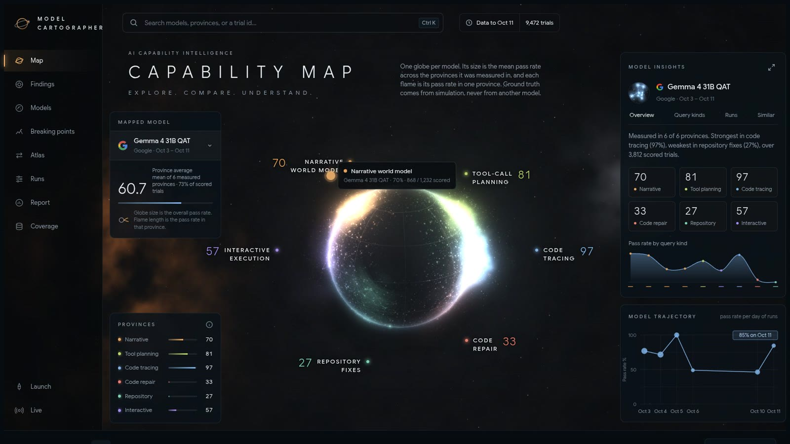

# Model Cartographer

**Where does your model break, and why?**

Benchmarks give a model one score. Model Cartographer generates tasks from simulated worlds, turns their difficulty up along real dials until a model stops passing, and reports where it broke in the task's own units ("breaks on 24-call plans with look-alike tool names"). The right answer always comes from running the world, never from another model's opinion: there is no LLM judge.

- **Live demo:** https://model-cartographer.vercel.app
- **Demo video (2:10):** _YouTube link_
- **Track:** Best Apps and Agents (Nebius × NVIDIA hackathon)
- **License:** MIT



## How it uses Nebius and NVIDIA Nemotron

Every Nemotron call, live or in a campaign, goes through **Nebius Token Factory**'s OpenAI-compatible API (`cartographer/exec/client.py`, provider `nebius`). Each Nemotron 3 tier does the job it suits:

| Where | Nemotron model | What it does |
|---|---|---|
| **Ask the Cartographer** (live on the site) | **Nemotron 3 Nano**, thinking off (~1 s) | Reads the visitor's question and picks the models and capabilities it is about, from lists the app supplies. |
| | **Nemotron 3 Super**, thinking on (~10 s) | Answers from the matching facts in the results store only, citing each fact. A deterministic audit then checks every number in the answer against those facts and highlights any it cannot find. |
| **Why did it fail?** (live, on any failed trial) | **Nemotron 3 Ultra** (serious reasoning, ~2–5 s) | Reads the task, the model's answer, the verified correct answer and the difficulty settings, and explains the mistake. The verifier's own classification is shown beside it. |
| **Capability report** | **Nemotron 3 Super** | Writes the diagnosis on the Report page from a deterministic evidence pack; every figure it quotes is audited (`scripts/write_report.py`, `cartographer/analyst/`). |
| **Campaigns** (the measurements) | **Nemotron 3 Nano 30B, Super 120B, Ultra 550B** | The models under test: 4,565 trials for **$5.86** of Token Factory spend. All three tiers ran the same tasks, so their breaking points compare directly. |
| **Story renderer and trap proposer** (optional) | Nemotron 3.5 Lightning, Nemotron 3 Super | Rewrite task stories in natural language (accepted only if another model can extract the original facts back, `cartographer/llmrender/gate.py`), and propose hard task settings for Nano. |

A live question costs about $0.0005 and an Ultra explanation about $0.001. Gemma 3 27B, Gemma 4 31B QAT and gpt-oss-120b ran the same tasks as comparison models.

### Where Token Factory sped up the work

- **Three model sizes behind one key and one endpoint.** Adding Nano, Super and Ultra was one provider entry, so every campaign could run the identical task stream against all three tiers. That side-by-side comparison is the product.
- **Cheap enough to measure properly.** At $5.86 for 4,565 Nemotron trials, we could afford adaptive campaigns, fresh-seed replications and automatic three-times re-runs of every failure, instead of one pass over a fixed benchmark.
- **Thinking on or off per call** (`chat_template_kwargs.enable_thinking`). The live agent routes questions with Nano in about a second, and spends reasoning tokens only where they pay off, in Super's answer and Ultra's explanations.
- **OpenAI-compatible API.** The same stdlib client runs campaigns, the analyst and the live agent, with one retry policy that honors `Retry-After`.

## What you see in the app

| Page | What it answers |
|---|---|
| **Map** | One globe per model. Size is the province average; each flame is the pass rate in one province of skill. |
| **Ask** | Ask anything about the map in plain words. Nemotron 3 Nano and Super answer live from the stored evidence, and every number is audited. |
| **Findings** | Weaknesses and strengths per model, with the difficulty region where each one fails. Every number opens the trials behind it, and each trial opens its full prompt, answer and verifier detail. |
| **Models** | All models side by side: province average, scored pass rate, coverage and findings. |
| **Breaking points** | The verdict per model and capability, in the task's own units, with a confidence grade. |
| **Atlas** | Every model on the same difficulty buckets for one query kind and dial: who degrades first, and how fast. |
| **Runs / Report / Coverage** | Raw runs with resample verification, the analyst's audited diagnosis, and what the instrument does and does not test yet. |

## The six provinces

| Province | Query kinds | Ground truth from |
|---|---|---|
| Narrative world model | state, order, belief, adversarial belief | replaying a simulated event log |
| Tool-call planning | tool plan | a simulated tool catalog with preconditions, decoys and look-alikes |
| Interactive execution | interactive (one call per turn) | the same simulator, stepped turn by turn |
| Code tracing | code trace | running the generated program |
| Code repair and writing | code repair (code writing built, not yet run) | hidden test inputs |
| Repository fixes | repo fix | running the repository's hidden tests |

## Run it locally

Requirements: Python 3.10 or newer. The app uses the standard library only, so there is nothing to install. `pytest` is needed only for the tests.

```bash
git clone https://github.com/Esl007/model-cartographer.git
cd model-cartographer

# 1. Unpack the campaign data (9,472 primary trials, frozen Oct 11 2026)
mkdir -p results
gunzip -c data/campaign-snapshot-2026-10-11.sqlite.gz > results/campaign.sqlite

# 2. Start the viewer; it opens http://127.0.0.1:8788/
python3 -m cartographer.viewer.serve results/campaign.sqlite
```

The Ask page and the "Why did it fail?" button call Nemotron live, so they need a Nebius key (step 1 below). Everything else works without one.

### Map a model yourself

1. Put your Nebius API key on the first line of `env/Nebius api.txt` (the folder is gitignored; keys are never logged).
2. Open **Launch** in the viewer, pick `nebius` and a model, and start the `full_map` preset (600-trial budget, about $0.10–0.30, 30–90 minutes). Or use the command line:

```bash
python3 scripts/run_campaign.py --list        # 45 campaigns, named <province>.<stressor>
python3 scripts/run_campaign.py --campaign II.traps --tier standard \
    --model nvidia/nemotron-3-super-120b-a12b --label super --provider nebius
```

Add `--dry-run` to print the run id and settings without calling any model. `--tier` is the single evidence dial (`scout`, `standard`, `rigorous`). Every run writes to `results/campaign.sqlite`, and the viewer shows new trials on refresh.

3. Regenerate the analyst report (calls Nemotron 3 Super on Nebius): `python3 scripts/write_report.py`

### Tests

```bash
python3 -m pip install pytest
python3 -m pytest -q          # 1,229 tests; tests/test_repo.py alone takes about 8 minutes
```

### Deploy your own copy

The hosted demo is the same viewer on Vercel's Python runtime, with a snapshot of the store bundled in (`deploy/vercel/`). Campaign launching is off there; the live Nemotron agent is on, rate-limited per visitor and capped per day (`ASK_PER_IP_10MIN`, `ASK_DAILY_USD`).

```bash
python3 scripts/build_vercel.py            # assembles dist/vercel/ (keys are never copied)
cd dist/vercel
vercel env add NEBIUS_API_KEY production   # paste your Nebius key when prompted
vercel deploy --prod
```

## How it works

1. **Task families** generate a latent world (entities, events, beliefs, tool catalogs, programs) from a seed, render it as text, and verify answers deterministically against that world.
2. **The adaptive scheduler** raises one difficulty dial at a time and fits a logistic frontier per model (`cartographer/schedule/`), so trials concentrate near the breaking point instead of filling a fixed grid.
3. **Resample verification** re-runs failures on fresh samples. Failures that pass on retest count as noise, not as weaknesses.
4. **Findings and breaking points** are derived from the store by the viewer itself, so every number on screen links to the trials behind it.
5. **The analyst** (Nemotron 3 Super) writes the diagnosis from an evidence pack, and a deterministic audit checks every figure it cites.

Design notes: `docs/architecture.html`, `docs/campaign-catalog.md`, `docs/findings.md`, and the per-province specs in `docs/`.

## Repository layout

```
cartographer/
  world/ toolworld/ interactive/ codeworld/ codefix/ repo/   task families (generate, render, verify)
  schedule/ campaigns/ confirm/ hunt/ ablate/ decompose/      adaptive probing, campaigns, verification, failure analysis
  exec/                                                       provider clients (Nebius, Groq, OpenRouter, Modal), pricing, keys
  store/                                                      append-only SQLite results store
  analyst/ report/                                            Nemotron analyst, audit, run verdicts
  viewer/                                                     the web app (stdlib HTTP server, static/map.html, ask.py live Nemotron agent)
scripts/        campaign runners, report writer, Vercel build
deploy/vercel/  hosted entry point and config
data/           frozen campaign snapshot
tests/          1,229 tests
```

## Limits

- Code writing is built but held out of live runs, because its spec under-determines some answers.
- Instruction following, numeric reasoning, long-context retrieval and non-text inputs are not covered yet (see the Coverage page).
- Models were mapped in different numbers of provinces; the Models page shows each model's coverage next to its average.
- The Report page is the analyst's snapshot from Sep 20 (1,305 trials, 3 models) and says so on the page.

## License

MIT, see [LICENSE](LICENSE).
